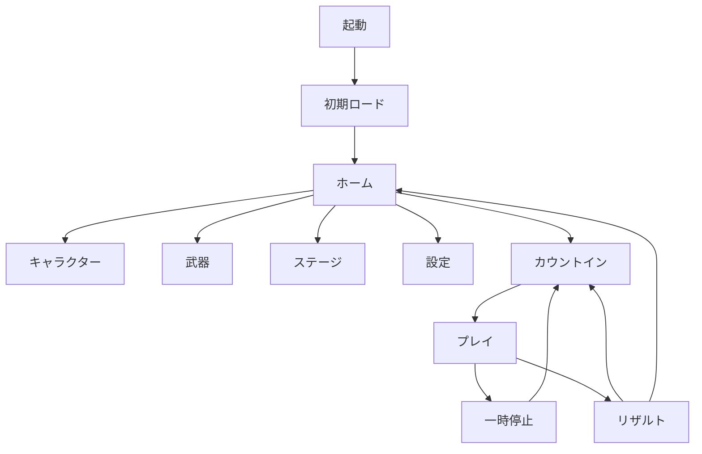

# UI・画面遷移仕様

## 1. UI原則

- 基準解像度1080×1920、Canvas Scalerは参照解像度方式。Safe Areaを必ず適用。
- 主要タップ領域は最低44×44 logical pt、推奨48以上。
- 基本パネルは濃紺、主要行動はシアン、成功・斬撃はコーラル、報酬は金、危険は赤橙。
- 色だけで状態を伝えず、形、アイコン、ラベルを併用。
- プレイ中は斬撃ライン、対象輪郭、拍表示を最前面。粒子や浮き文字より優先。
- 戻る、決定、装備、購入を同じ場所・同じ見た目で使い回す。

## 2. 画面遷移

## 3. 画面別仕様

### 起動・スプラッシュ

- 中央上部にロゴ領域、中央下にハムスターのキービジュアル。
- 表示は必要最小時間のみ。タップ待ちにしない。
- OSやエンジン上必要な表記以外のボタンなし。

### ロード

- ハムスターの走行ループまたはステージイラスト。
- 実進捗を取得できる場合だけバーを進める。偽の百分率を出さない。
- 失敗時: `再試行` と `ホームへ`。エラーコードは詳細画面に分離。

### ホーム

- 主ボタン: `プレイ`。画面下中央で最大。
- 上部: プレイヤーアイコン、レベル表示候補、コイン。
- 下部: `キャラ`、`武器`、`ステージ`、`設定`。
- 中央: 選択中キャラと武器の3Dプレビュー。
- 未保存変更は即時装備保存するか、画面離脱時に一度だけ確定。方式を混ぜない。

### キャラクター選択

- 1体を中央で大きく表示。下部カードにハムスター、黒猫、人間、ロボ。
- カード状態: 選択中、所持、未所持、未解放。
- ボタン: 所持済みは`装備`、未所持は価格付き`入手`、条件不足は鍵と条件。
- MVPはハムスターのみ正式素材。他はカードとデータ差替えを検証する仮素材でよい。

### 武器選択

- キャラが実際に持つプレビューと武器単体カード。
- 形、軌跡色、装飾音のプレビュー。性能数値は表示しない。
- 購入二度押しを防ぎ、保存完了後に`装備中`へ更新。

### ステージ選択

- ジオラマカード。巨大キッチン、玩具部屋、空中果樹園、ネオン街を最初の候補として表示。
- MVPは巨大キッチンのみプレイ可能。他は`開発中`または非表示。購入可能に見せない。

### 設定

- 音楽、効果音、合図音を0〜100%。
- 振動ON/OFF、演出強度: 弱/標準、画面揺れON/OFF。
- タイミング補正: -250〜+250ms、10ms刻み。符号の意味を短く説明。
- `タイミング調整を試す`、`チュートリアルを再生`、`初期値に戻す`。
- 初期化は確認ダイアログを出す。セーブ全削除とは分ける。

### プレイ

| 位置 | 表示 |
|---|---|
| 左上 | 距離 |
| 上中央 | 8拍ドット。裏拍時のみ中間パルス |
| 右上 | スコア、ポーズ |
| 右上内側 | HPハート3個、コンボ |
| 72%高 | 斬撃ライン |
| 85%高 | キャラクター |

- タッチ領域は下部の左・中央・右を各3分割。レーン可視線は薄く、入力時だけ軽く反応。
- PERFECT/GOOD/MISSは0.4秒以内を目安に対象付近へ表示し、次対象を覆わない。
- 裏拍導入直前は拍ドット間の小点と対象の二重リングを表示。
- HP0後は入力受付と採点を止め、0.6〜1秒以内に結果へ。

### 一時停止

- `再開`、`やり直す`、`設定`、`ホームへ`。
- 再開は3または4拍のカウントイン。即復帰しない。
- やり直し・ホームは確認。今回の未確定報酬は付与しない。

### リザルト

- 今回の距離、スコア、最大コンボ、P/G/M、コイン、ベスト更新。
- 主ボタン`もう一度`、副ボタン`ホーム`。
- 記録更新だけ短い特別演出。集計演出はスキップ可能。
- 報酬保存中は二度押しを無効化。保存失敗時は再試行。

## 4. ボタン状態

全ボタンは `normal / pressed / disabled / loading / selected` を持つ。非活性は彩度を下げ、理由が必要なら近くへ短く表示。ロード中ボタンはラベルを消さず、小さな進行表示を添える。

## 5. 文言基準

短い動詞を優先: `プレイ`、`装備`、`入手`、`再開`、`もう一度`、`ホーム`。英語版は `PLAY / EQUIP / GET / RESUME / RETRY / HOME`。コンセプト画像内の文字や数値は例示であり実装正本ではない。

